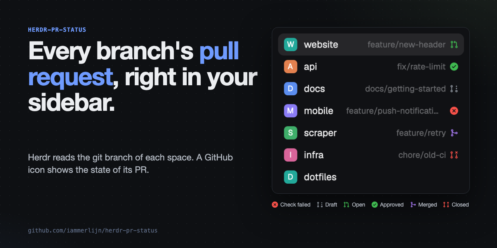
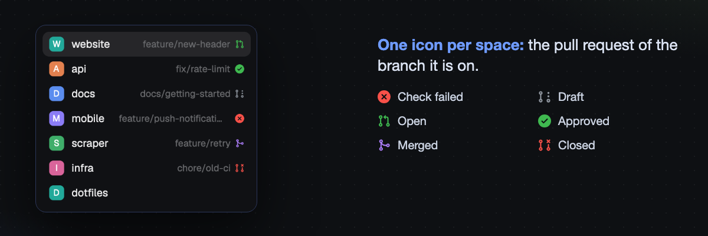
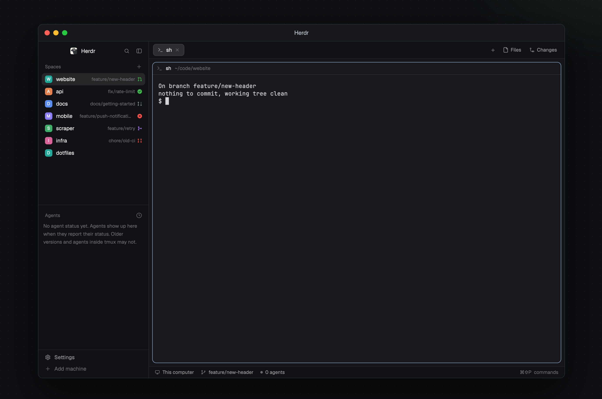

# Herdr PR Status



The pull request status of each space as a GitHub icon in the spaces list of the [Herdr](https://herdr.dev) desktop app. It sits at the right end of the row, after the branch and the ahead/behind counts.



- **From the branch, nothing else.** The mod reads the git branch of each terminal in a space, on this computer and on other machines. It works with any GitHub repo and any issue tracker.
- **One icon per space.** A space with more than one PR (a backend and a frontend repo, for example) shows the most urgent one.
- **Nothing to set up.** It uses `gh`, logged in on this computer. There are no settings, and the mod stores nothing but its icons.



| Icon ([GitHub Octicons](https://github.com/primer/octicons)) | PR |
| --- | --- |
| `x-circle-fill`, red | open, and a check failed |
| `git-pull-request-draft`, grey | draft |
| `git-pull-request`, green | open |
| `check-circle-fill`, green | open and approved |
| `git-merge`, purple | merged |
| `git-pull-request-closed`, red | closed |

A space with more than one PR shows the first state in this table.

## Install

You need [`gh`](https://cli.github.com), logged in (`gh auth status`).

```sh
git clone https://github.com/iammerlijn/herdr-pr-status.git
cp -R herdr-pr-status/mods/pr-status ~/.config/herdr-app/mods/
```

The mod finds the PRs and shares them. The spaces list draws the icons, so it needs a patch of 2 lines. Find the mod of the block with `"id": "spaces"` in your layout (`herdr-app status` names the layout, in `~/.config/herdr-app/layouts/<name>.json`).

**Herdr's own `spaces`.** Herdr's mods are read-only, so patch a copy and use the example layout:

```sh
herdr-app do mod.clone --name spaces --as spaces-pr
patch -p1 -d ~/.config/herdr-app/mods/spaces-pr < herdr-pr-status/patches/spaces.patch
cp herdr-pr-status/examples/main-pr-status.json ~/.config/herdr-app/layouts/
herdr-app do layout.switch --name main-pr-status
```

**[Space folders](https://github.com/jankeesvw/herdr-space-folders).** Patch it in place:

```sh
patch -p1 -d ~/.config/herdr-app/mods/space-folders < herdr-pr-status/patches/space-folders.patch
```

Then add the `pr-status` block to the `sidebar` column of your layout, before `sidebar-footer`. A mod starts only when its block shows, so it gets 1 px:

```json
{ "id": "pr-status", "type": "block", "size": { "px": 1 }, "content": { "mod": "pr-status" } }
```

**Another spaces mod.** Add the same 2 lines where it draws a space row (see `patches/`), and the block above.

Check: `herdr-app check ~/.config/herdr-app/mods/pr-status`. An AI agent can install it from `RECIPE.md`.

## What it runs

Every 2 minutes, for each space:

1. Each terminal in the space gives its live folder and git branch (from Herdr). Terminals that are not in a git repo are skipped.
2. `git remote get-url origin` and `git symbolic-ref refs/remotes/origin/HEAD`, on the space's machine, give the GitHub repo and its default branch. A terminal on the default branch is skipped. The repo of a folder is kept after the first look.
3. `gh pr view <branch> -R <owner/repo> --json …`, on this computer, gives the PR.

All spaces and folders are checked at the same time. Commands run without a shell: the branch and the folder go only as arguments. A machine that is offline, a missing `gh` or an answer that isn't JSON gives no icon, and the next check tries again.

The mod shares the result as `shared("pr-status")`: `{ [space id]: { icon, color, url } }`. A mod can't draw in another mod's block, so the spaces list draws it. Herdr draws images only from real folders, and a mod folder is often a link to its git checkout, so the mod writes its 6 icons to `~/.config/herdr-app/data/pr-status/` when it starts.

## Good to know

- The icon can take up to 2 minutes to change after a terminal changes branch, or after the PR changes on GitHub.
- Only the terminals' own folders count. A program that works in another folder (an agent in a worktree, for example) doesn't change the branch of its terminal.
- Herdr doesn't reload a mod from a linked folder when a file changes: copy it, or give its block another `id` in the layout.

## License

MIT (`LICENSE`). The icons are [GitHub Octicons](https://github.com/primer/octicons), MIT, Copyright (c) GitHub Inc. `patches/spaces.patch` and `examples/main-pr-status.json` change the spaces mod and the main layout that ship with Herdr; that code keeps Herdr's Apache License 2.0 (`LICENSE-APACHE`).
