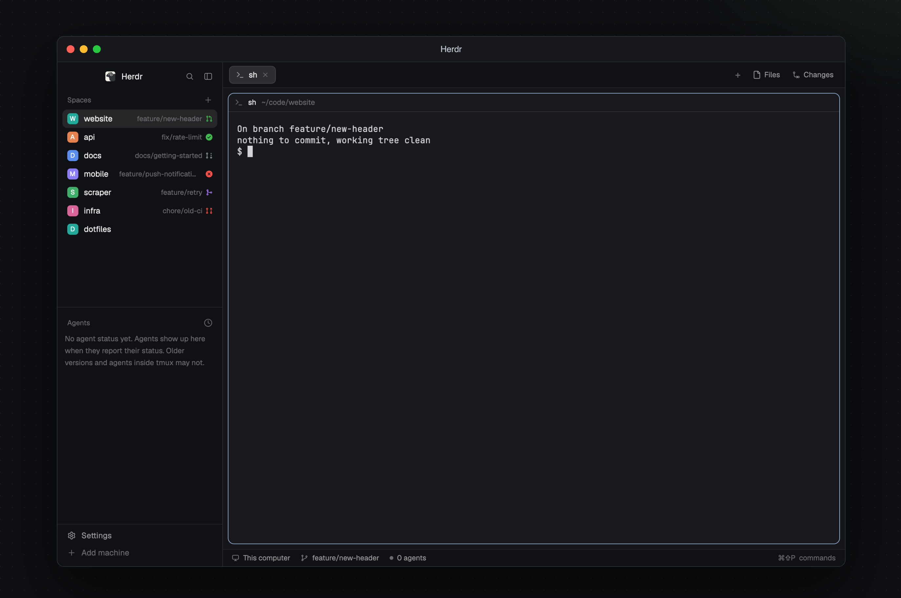

# Herdr PR Status

A GitHub icon at the right end of each space row in Herdr's spaces list: the state of the pull request of the branch that the space's terminals are on.

## Before you install

- Check that `gh` is installed and logged in on this computer (`gh auth status`). Without it the mod runs but shows no icons. For GitHub Enterprise, `gh` must also be logged in to that host.
- Look at which mod draws the spaces list in the person's shown layout (`herdr-app status` names the layout; find the block with `"id": "spaces"` in `layouts/<name>.json`).
  - **`spaces`** (Herdr's own, read-only): `herdr-app do mod.clone --name spaces --as spaces-pr`, then `patch -p1 -d ~/.config/herdr-app/mods/spaces-pr < patches/spaces.patch`. If the shown layout is Herdr's `main`, copy `examples/main-pr-status.json` to `layouts/` and `herdr-app do layout.switch --name main-pr-status`. For another layout, ask the person first, then set that block's mod to `spaces-pr` and add the `pr-status` block below.
  - **`space-folders`** (Jankees van Woezik's space folders): ask the person first, then `patch -p1 -d ~/.config/herdr-app/mods/space-folders < patches/space-folders.patch` and add the `pr-status` block below.
  - **Any other mod:** ask the person. Add the 2 lines of the patches where it draws a space row: `const pr = shared("pr-status")?.[w.id];` and, as the row's last child, `svg(pr.icon).size(11).flex_none().ml(-4).text_color(pr.color)` when `pr` is set.
- Copy `mods/pr-status/` to `~/.config/herdr-app/mods/`.
- The `pr-status` block, in the `sidebar` column before `sidebar-footer`: `{ "id": "pr-status", "type": "block", "size": { "px": 1 }, "content": { "mod": "pr-status" } }`. A mod starts only when its block shows, so 0 px doesn't work.

## What you see

- Each space row as before. When the space has a PR: an 11 px Octicon at the right end, after the branch and the ahead/behind counts, 5 px from them.
- `x-circle-fill` `#f85149`: open, and a check failed. `git-pull-request-draft` `#9198a1`: draft. `git-pull-request` `#3fb950`: open. `check-circle-fill` `#3fb950`: approved. `git-merge` `#ab7df8`: merged. `git-pull-request-closed` `#f85149`: closed.
- No icon: no terminal in a git repo with an `origin` on github.com or a GitHub Enterprise host that `gh` is logged in to, only the default branch, or no PR for the branch.

## How it behaves

- At start, and then every 2 minutes (`EVERY`), not while a check still runs.
- For each space: the panes in its tabs (`panes()`, `p.tab` in `space.tabs`) that have a `branch` and a `cwd`. One check per folder.
- For each folder, on the space's machine (`exec(…, { on: space.machine })`): `git -C <cwd> remote get-url origin` (a URL or SCP-form remote whose host is one of the hosts in `gh auth status --json hosts`, read once on this computer; without an answer only `github.com`), then `git -C <cwd> symbolic-ref --short refs/remotes/origin/HEAD`. The branch that equals the default branch is skipped. A found repo is kept per machine and folder, and folders that look at the same time share one look; a failure is not kept, so it is tried again.
- On this computer: `gh pr view <branch> -R <host/owner/repo> --json state,isDraft,reviewDecision,statusCheckRollup`. One look per repo and branch in each check, shared by all spaces.
- State: `MERGED` → merged, `CLOSED` → closed, `isDraft` → draft, a check with conclusion or state `FAILURE`, `ERROR`, `TIMED_OUT`, `CANCELLED`, `ACTION_REQUIRED` or `STARTUP_FAILURE` → failing, `reviewDecision` `APPROVED` → approved, else open. Several PRs in a space: the first state in the order failing, draft, open, approved, merged, closed.
- All spaces and folders run in parallel. The result goes to `setShared("pr-status", { [space id]: { icon, color } })`.

## Built from

- **Mod** `mods/pr-status/`: a `View` that draws an empty `div()`. `exec`, `spaces`, `panes`, `setShared`. No Node APIs.
- **Icons**: GitHub Octicons (MIT), 16 px, one file per state: `mods/pr-status/icons/<state>.svg` with `fill="currentColor"`, drawn with `svg("mods/pr-status/icons/<state>.svg")`. This works when the mod folder is a link.
- **Patches** `patches/spaces.patch` (Herdr's `spaces`, November 2026) and `patches/space-folders.patch`: 2 lines each in `row()`.
- **Layout** `examples/main-pr-status.json`: Herdr's `main` with the `spaces` block's mod set to `spaces-pr` and the 1 px `pr-status` block.

## Watch out

- Every `exec` goes through `run()`, which turns a failed start into an exit code: an offline machine must not stop the check of the other spaces.
- No shell: the branch and the folder are arguments, never part of a command line. Git doesn't allow a branch name that starts with `-`.
- `gh` runs on this computer, `git` on the space's machine: the remote doesn't need `gh`.
- `exec` uses the person's login environment, so `gh` must be on the PATH of their login shell.
- Herdr doesn't reload a mod from a linked folder when a file changes: copy it, or give its block another `id`.

## Done when

- `herdr-app check ~/.config/herdr-app/mods/pr-status` and `herdr-app check` on the patched spaces mod pass.
- `ls ~/.config/herdr-app/mods/pr-status/icons/` lists 6 `.svg` files.
- A space whose terminal is on a branch with an open PR shows the green `git-pull-request` icon within 2 minutes; a space on `main` shows none.
- `shared("pr-status")` in `~/.config/herdr-app/shared.json` has an entry per space with a PR.
